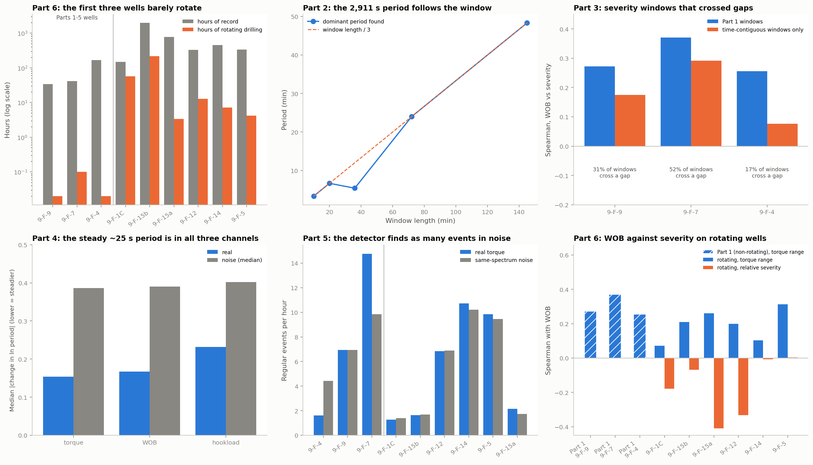

# Stick-Slip Detection from Raw Drilling Telemetry (Signal Processing, Oilfield R&D)

https://github.com/ramith001/oilfield-signal-processing

Can torsional stick-slip be detected and graded from the surface telemetry of real drilling operations? This project works on the public Volve field data released by Equinor (2-3 s sampled weight on bit, torque, rotary speed, bit depth, hookload from WITSML real-time logs), parsing the raw XML, cleaning sensor artifacts, and testing each claim against a noise null instead of reading peaks off a spectrum.

**Short answer: not from this data.** The three wells the project started with are almost entirely not rotating, the period first reported for one of them was an artifact of the window used, and on six later wells that did rotate while drilling, neither spectral peaks nor an automatic event detector stand out against noise with the same spectrum. What the project does produce is a documented chain of checks that shows why, and a set of findings about WOB, depth and ROP that did not survive more data. `CASE_STUDY.md` is the short write-up; `data/chart_summary.png` shows one result from each part.



## Findings

- **The first three wells are not drilling wells in these logs (Part 6).** Surface rotary speed is above 0.5 rev/s for 0.2, 0.1 and 0.1 hours of 33.7, 41.3 and 166.1 hours of record in 9-F-9, 9-F-7 and 9-F-4. The torque used in Parts 1 to 5 is torque variation on a stationary string. Six more wells (9-F-1C, 9-F-15a and 9-F-15b, 9-F-12, 9-F-14, 9-F-5) have 3 to 216 hours of rotating drilling each.
- **The ~2,911 s period for 9-F-4 is an artifact (Part 2).** It equals the segment length divided by 3, the lowest frequency the search rule allowed, and follows the window length when the segment is cut shorter.
- **The Part 1 severity windows crossed gaps (Part 3).** 17% to 52% of them span more than 120 s. On time-contiguous windows the WOB-severity correlation falls from 0.27, 0.37, 0.26 to 0.18, 0.29, 0.08.
- **WOB and depth do not generalize (Part 6).** On rotating wells, torque oscillation relative to mean torque is unrelated or negatively related to WOB (-0.41 to 0.00), and falls with depth only because mean torque rises with depth. 9-F-4's strong positive depth result does not replicate.
- **Severity has no detectable cost in ROP (Parts 3 and 6).** ROP and MSE are zero in all three original wells; in 9-F-1C and 9-F-15b, relative severity against ROP after removing WOB and rpm is -0.03 and -0.11 with intervals that include zero.
- **There is a steady spectral feature near 25 s, shared by every channel (Parts 4 and 6).** In 9-F-4 the dominant period persists from window to window, and WOB and hookload do too. On rotating wells it stays at 25 to 27 s from 100 to 4,700 m, so it does not scale with string length. The expected torsional period (about 1.3 to 6 s for these depths, an estimate) is at or below the data's 5.6 s sampling limit.
- **The detector measures amplitude, not stick-slip (Parts 5 and 6).** Its amplitude tracks the severity index (Spearman 0.37 to 0.84 across wells), but regular events occur as often in phase-randomised noise with the same spectrum as in the real torque (for example 6.9 against 6.9 per hour in 9-F-9 and 1.6 against 1.7 in 9-F-15b), and a noise-only series triggers an event in 37% to 61% of synthetic cases.

## Parts

| Part | What was done | Main result | Script |
|---|---|---|---|
| 1 | Pull WITSML telemetry, clean artifacts, FFT period, WOB and bit-depth severity checks on three wells | Period and correlations reported; later parts qualify them | `extract_witsml.py`, `signal_analysis.py`, `bitdepth_analysis.py`, `multi_well_validation.py` |
| 2 | Re-test 9-F-4's 2,911 s period with a calibrated red-noise peak test | Artifact; no supported in-band period; 14 s sampling cycle found | `extract_f4_extra.py`, `f4_period_stability.py` |
| 3 | ROP and MSE against severity | Not answerable on these wells; severity windows crossed gaps | `rop_mse_vs_severity.py` |
| 4 | Spectrogram of the dominant period over time | Only 9-F-4 has enough live torque; steady ~25 s feature also in WOB and hookload | `spectrogram_analysis.py` |
| 5 | Automatic event detector with severity labels, validated against the index | Amplitude agrees with the index; events as frequent in same-spectrum noise | `stickslip_detector.py` |
| 6 | Six more Volve wells | First three barely rotate; WOB and depth findings do not carry over; same noise result | `extract_extra_wells.py`, `extra_wells_validation.py`, `extra_wells_spectral.py` |
| 7 | Summary figure, README, case study | This page, `CASE_STUDY.md`, `data/chart_summary.png` | `summary_figure.py` |

## Limitations

- **Sampling.** Rows are spaced 3, 3, 3, 3, 2 s (mean 2.8 s), so the Nyquist limit is 5.6 s. Classic surface stick-slip periods for strings of 1,000 to 4,700 m are expected at roughly 1.3 to 6 s (4 L / c with c near 3,000 m/s, an estimate), so this data cannot resolve most of them. High-rate surface or downhole data would be needed.
- **Few and unequal wells.** Nine wells, three of them nearly static, two of them (9-F-1C and 9-F-15b) holding most of the rotating hours. Wells that share a rig and period are not independent.
- **Windows are serially dependent.** Correlations on rotating wells use run-level bootstrap intervals, and spectral p-values come from a parametric noise bootstrap calibrated on simulated data (4% false positives at a nominal 5%, low power for small peaks).
- **Torque is a surface average.** A surface torque channel integrates string dynamics, and severity and MSE come from the same channel, so some correlations between them are mechanical.
- **Second data source.** Wells added in Part 6 come from a converted third-party store (DrillDash) in SI units without TORQUE_MAX; the saturation cut was applied to mean torque at 32,000 N.m. The converted copy of the three original wells in the same store also shows 0.1 hours of rotation each, so the lack of rotation is not an artifact of the first source.
- **Licensing.** The Volve data are released by Equinor under CC BY-NC-SA 4.0 (non-commercial, attribution, share-alike); the extra wells in `data/extra_wells/` are slim derived copies and fall under the same licence.

## Reproducing

```
pip install requests pandas numpy scipy matplotlib polars   # polars only if pyarrow has no wheel for your platform
python extract_witsml.py            # three wells from the mirror (writes raw_xml/, git-ignored, and data/f*_drilling_telemetry.csv)
python extract_f4_extra.py
python signal_analysis.py
python bitdepth_analysis.py
python multi_well_validation.py
python f4_period_stability.py
python rop_mse_vs_severity.py       # needs raw_xml/
python spectrogram_analysis.py
python stickslip_detector.py
python extract_extra_wells.py       # downloads about 700 MB once; data/extra_wells/ is already committed
python extra_wells_validation.py
python extra_wells_spectral.py
python summary_figure.py
```

Each script uses fixed random seeds. A full run takes a few minutes apart from the downloads.

## Detailed notes by part

These are the original notes in the order they were written. Later parts qualify earlier ones; the corrections are collected in "Corrections to earlier parts" below, and the findings above are the current reading.

- Pulled ~33.6 hours of real, 2-second-sampled surface drilling telemetry (WOB, torque, RPM, ROP, hookload) for Volve field well NO 15/9-F-9 directly from Equinor's public WITSML release, parsing raw XML rather than using a pre-cleaned mirror, and reverse-engineered the WITSML column-ordering convention by cross-checking a curve's own embedded description text against its physically expected value at the very first timestamp.
- Caught and fixed a real sensor artifact before drawing any conclusions from it: the single longest "active drilling" block by row count (2.2 hours) turned out to have a completely frozen torque reading for its entire span, and 88.6% of all active-drilling rows sit inside a 60-second window where torque never updates at all. Built a local-variation filter (minimum distinct values in the surrounding 60s window) to separate genuinely live torque samples from stale/held-over sensor values, rather than analyzing "the longest block" or "all rows" as originally planned.
- Also found and excluded a 16-bit integer saturation artifact: torque values ramp up toward and back down from 32,767 (2^15-1) over several consecutive samples, well above the 99.99th percentile of genuine readings elsewhere in the record (~7,900 N·m) - excluded any row within that saturation ramp (TORQUE_MAX ≥ 15,000 N·m, not just the exact ceiling value) rather than just the rows that hit 32,767 exactly.
- Ran an FFT/periodogram on the longest genuinely-live drilling segment (4.8 minutes) after detrending and windowing: the dominant torque oscillation period is 23.8 seconds, inside the 5-120s range physically expected for torsional stick-slip in a drillstring of this length - reported as an indicative single-segment finding rather than an over-claimed precise measurement, given the short segment length.
- Built a rolling 60-second stick-slip severity index (peak-to-trough torque range) across every genuinely-live sample in the record and compared it against weight-on-bit (WOB) level, since the originally planned validation against rate-of-penetration (ROP) wasn't possible once ROP/MSE turned out to be entirely zero in this log stream. Result: a modest positive rank correlation (Spearman r = 0.27), with severity rising fairly steadily across the bottom four WOB quintiles before easing off at the highest WOB level - reported as a non-monotonic, real result rather than smoothed into a cleaner story.
- Checked whether stick-slip severity also varies with hole depth (BITDEP), alongside the WOB relationship above (`bitdepth_analysis.py`): over this run's ~69m depth interval, severity shows a modest negative rank correlation with depth (Spearman r = -0.25) that partially survives controlling for WOB (partial correlation = -0.19) - reported with the caveat that this is a single interval within one drilling block of one well, not a well-length depth sweep.
- Extended both the stick-slip-period and the WOB/depth severity checks to two more Volve wells (9-F-7: ~2.4 days; 9-F-4: ~7 days), since the mirror repo turns out to hold three wells with real-time drilling-parameter telemetry, not one, each needing its own real-time log object identified rather than assumed from 9-F-9's numbering (`extract_witsml.py`, `multi_well_validation.py`). The WOB-severity relationship replicates in direction on all three wells (Spearman r = 0.27, 0.37, 0.26). The stick-slip period itself stays inside the 5-120s theoretical band for two of three wells (23.8s, 40.9s) but comes out at ~2911s on 9-F-4's much longer live segment (145 min vs. 7-9 min on the other two), most likely picking up slower drilling-state variation rather than short-period torsional stick-slip - reported as a real divergence rather than discarded. The depth-severity relationship is the most well-specific finding: negative on 9-F-9 (r=-0.25, partial r=-0.19), effectively gone once WOB is netted out on 9-F-7 (raw r=+0.26, partial r=-0.05), and a real, strong positive effect on 9-F-4 (r=+0.46, partial r=+0.43) - the one well whose live rows actually span a wide depth range (2,615m vs. 9-F-9's 69m). See `data/chart_multi_well.png`. (Part 2 below re-tests the ~2911 s figure and finds it to be an artifact of the segment it came from.)
- **Re-tested well 9-F-4's ~2911 s stick-slip period (Part 2: `extract_f4_extra.py`, `f4_period_stability.py`). It is not confirmed: it was an artifact of the single segment it came from, and no stable in-band period for 9-F-4 can be established from this data either.** "Pull more sections of 9-F-4" turned out not to be possible: scanning every log object the mirror holds for the well shows the 22 chunks already in use are the only time-indexed log with torque and WOB, spanning the whole ~7 days, so there is nothing further to download. The test instead uses the existing week far more thoroughly than Part 1's single block did.
  - *Why 2911 s was an artifact.* Part 1 FFT'd one 145.6-minute block (only 50% of its rows are live torque; the rest is frozen readings filled in by interpolation) and took the largest peak above a minimum frequency of 2 / (segment length). The reported period is exactly segment length / 3.00, i.e. the third FFT bin, the lowest one that search rule allowed, and 93% of that block's spectral power sits at periods slower than 300 s. Cutting the same block into shorter windows and applying the same rule, the dominant period follows the window length instead of staying near 2911 s (median 200 s in 10-minute windows, 400 s in 20-minute, 1,440 s in 72-minute, 2,900 s in the full block; the 36-minute windows, only four of them, are the one exception, at 324 s). A physical oscillation would not do that.
  - *Is there any real in-band period?* The data for answering is thin: 9-F-4 has 123 minutes of live torque in total, split into 56 contiguous sections (the longest is 73.5 minutes, only six are at least 5 minutes). Each live section was cut into non-overlapping 5-minute windows (23 in all, 3-minute windows as a sensitivity check) and tested for a spectral peak in the 5-120 s band larger than a smooth red-noise background explains, with p-values from a parametric bootstrap (the test is calibrated on simulated noise: 4% false positives at a nominal 5%, but only 31% of 5-minute windows flag an injected 40 s oscillation of moderate size, so it is not sensitive to weak signals). Individually, 2 of 23 windows are significant, about what chance gives (1.2). Pooling the windows (a stable period should recur at the same frequency) gives a borderline peak at 14.9 s (p = 0.047), but WOB and hookload, channels that should not carry a torsional oscillation, show the same peak at the same period (p = 0.066 and 0.076), so it is not specific to torque. Restricting to 20-120 s, torque's best pooled peak is at about 25 s (p = 0.076), and the WOB and hookload controls show nothing there (p = 0.56 and 0.73). The 73.5-minute section alone gives p = 0.14 and 0.19, and the 3-minute windows pool to p = 0.32 and 0.45. So: no in-band period for 9-F-4 is supported, though with this little contiguous live data and this sensitivity, absence of evidence is weak evidence of absence.
  - *The 14 s sampling cycle.* Rows are not 2 s apart as Part 1's uniform-grid interpolation assumes: in all three wells the spacing repeats 3, 3, 3, 3, 2 seconds (mean 2.8 s), a 14 s cycle, and the true sampling limit is about 5.6 s, so the bottom of the 5-120 s band sits at the Nyquist limit. The shared 13-15 s feature above is consistent with this cadence rather than with drilling physics, though that is an inference, not something this data can settle. Using only native timestamps (for example a Lomb-Scargle periodogram) would avoid the interpolation.
  - *What this implies for Part 1's other two periods.* Running the same test on the segments Part 1 used: 9-F-9's 23.8 s peak survives (11.2 times its background, p = 0.03), but it comes from a single 6.7-minute segment chosen as the best live block, so that p-value is not corrected for the selection; 9-F-7's 40.9 s does not stand out (2.1 times its background; the strongest in-band peak in that segment has p = 0.85). Part 1's statement that the period "stays inside the 5-120 s band for two of three wells" is therefore supported for one well at most. The WOB-severity and depth-severity correlations are not affected, since they use the rolling severity index, not the FFT. See `data/chart_f4_period_stability.png`.
- **Tested ROP and MSE against stick-slip severity (Part 3: `rop_mse_vs_severity.py`). The data cannot answer "does stronger stick-slip cost drilling efficiency", and checking why exposed a problem in Part 1's severity windows.**
  - *Is ROP or MSE populated anywhere?* No. Part 1 saw `ROP_AVG` and `MSE` identically zero in 9-F-9's log; checking every log object the mirror holds for all three wells (4 log objects) and every related channel (`ROP_AVG`, `MSE`, `I_MSE`, `DMSE`, `DWOR`, `MIN_2M`, `MIN_5FT`, `ONBOTTOM_TIME`) finds 0 non-zero rows in any of them (`data/rop_mse_channel_audit.csv`). The hole-depth channel (`Depth`) is a constant that never updates, so bit depth (`BITDEP`, metres) is the only route to a derived ROP.
  - *Do Part 2's findings affect severity, ROP or MSE?* Three do. The 3, 3, 3, 3, 2 s row cadence means Part 1's "60 s" window of 30 rows is 29 gaps x 2.8 s = about 81 s (a constant, so it changes the label, not the ranking), and means a derived ROP must use the real timestamps, since a nominal 2 s grid would overstate it by about 40%. The zeroed `TQ_IN_AMPS*` channels and log 8's duplicated torque mean there is no independent torque channel to check the torque that both severity and MSE are built from. Log 8's `ROP_AVG` is also zero.
  - *A separate problem in Part 1's severity windows, found while checking.* The rolling window runs over the filtered code-114 rows, so it is not a window in time: at the edge of a drilling block it spans the gap to the next block (median span 100 s on 9-F-9, 375 s on 9-F-7, 81 s on 9-F-4; the longest reach 10,190 s, 20,956 s and 73,862 s). 294 of 953 windows on 9-F-9, 248 of 477 on 9-F-7 and 402 of 2,422 on 9-F-4 span more than 120 s. Restricting to time-contiguous windows (span at most 120 s) leaves 659, 229 and 2,020 windows and changes the Part 1 correlations: WOB-severity Spearman r goes from 0.272, 0.371, 0.256 to 0.175, 0.291, 0.076 (9-F-9, 9-F-7, 9-F-4). The depth-severity result is more robust: 9-F-9 raw r -0.247 to -0.188 (partial -0.193 to -0.145), 9-F-7 raw 0.264 to 0.236 (partial -0.054 to 0.005), 9-F-4 raw 0.456 to 0.515 (partial 0.430 to 0.514; 933 windows to 619). Overlapping windows mean these n are not independent samples, so the corrected correlations are descriptive, not tested. See `data/severity_window_contiguity.csv`.
  - *Can ROP be derived from bit depth?* Barely. A window counts as advancing if `BITDEP` rises over it at 0 to 150 m/h. Of the time-contiguous severity windows, `BITDEP` is flat in 344 of 659 (9-F-9), 229 of 229 (9-F-7) and 1,991 of 2,020 (9-F-4). Advancing windows: 83 on 9-F-9 (9 separate segments, about 5 minutes of clock time in total), none on 9-F-7, and 29 on 9-F-4, all from one segment and all the same single 2.77 m step, so that is one depth update, not a rate. On 9-F-4, `BITDEP` is zero or negative in 2,036 of its 3,684 live rows. (`data/rop_derivation_feasibility.csv`.)
  - *What 9-F-9's advancing windows show.* Derived ROP is 1.2 to 53.3 m/h (median 2.6), at 5 to 7 rpm, which is slow rotation, not the rpm of a drilling-ahead interval. The MSE used is the Teale form with the bit area left out (MSE x area = WOB + 2 pi N T / ROP, in N; the bit diameter is not in this telemetry, and it scales both terms, so rank correlations are unaffected within one hole section). Spearman correlation with severity, over the 83 overlapping windows and over the 9 segment medians: derived ROP -0.28 (p = 0.011) and -0.05 (p = 0.90; leave-one-segment-out range -0.26 to +0.36); MSE index +0.47 and +0.42 (p = 0.27, range +0.17 to +0.57); for comparison, mean torque +0.74 and +0.90. The window-level numbers rest on overlapping windows and should not be read as significance; the segment-level ones (n = 9) show no detectable relationship either way, which is not evidence of none. The MSE correlation is also partly mechanical: severity (torque range) and MSE (mean torque, in the numerator) come from the same torque channel, and severity correlates with mean torque at +0.90 across segments, so a positive severity-MSE correlation would be expected even if stick-slip cost nothing. See `data/chart_rop_mse.png` and `data/rop_mse_9f9_*.csv`.
  - *What would be needed.* Wells whose log streams carry a populated `ROP_AVG` or `MSE`, or a depth channel that tracks the bit through a drilling-ahead interval, with a severity index computed over time-contiguous windows. 9-F-9, 9-F-7 and 9-F-4's real-time logs in this mirror are not that.
- **Followed the dominant torque period through time with a spectrogram (Part 4: `spectrogram_analysis.py`). Only 9-F-4 has enough live torque to do it, and what it shows is a steady spectral feature near 25 s that is not specific to torque.**
  - *How much data each well has.* A 5-minute window needs 5 minutes of contiguous live torque. 9-F-4 has 169 minutes of live torque in 56 sections, 130 minutes of it in the six sections of at least 5 minutes, which gives 44 windows at 50% overlap (about 23 independent). 9-F-9 has 55 minutes in 66 sections but only one section reaches 5 minutes (6.7 min, one window), and 9-F-7 has 21 minutes in 28 sections with one section of 8.9 minutes (two windows). So 9-F-9 and 9-F-7 cannot be shown as a spectrogram; their windows are plotted as spectra in `data/chart_spectrogram.png` panel E. (`data/spectrogram_live_inventory.csv`.)
  - *Method.* Each window uses the Part 2 pipeline unchanged: 2 s re-gridding, prewhitened periodogram divided by a fitted red-noise background, and the bootstrap test for the largest in-band ratio. WOB and hookload go through the same windows as controls. The 20 to 120 s band avoids the 14 s sampling cycle; 5 to 120 s is reported as well.
  - *Is there a peak?* In 3 of 44 windows the torque peak in 20 to 120 s is above the 5% line (about 1.2 expected by chance among 23 independent windows), and in 3 of 44 over 5 to 120 s (at 15.7, 17.5 and 19.9 s). In the clean band, WOB exceeds the same line in 1 of those 3 windows and hookload in 1. That is not a stick-slip signal.
  - *Does the dominant period stay put?* The median absolute change in the log of the strongest 20 to 120 s period between consecutive windows is 0.15, against 0.39 for simulated noise (p = 0.003); 82% of windows have their strongest period between 20 and 35 s (median 25 s, quartiles 23 and 33 s). The noise null is a continuous series per real section with the section's own spectral slope, cut into the same overlapping windows, so overlap is accounted for. The controls behave the same way: WOB 0.17 (p = 0.003) with a median strongest period of 27 s, hookload 0.23 (p = 0.033) at 28 s. Over 5 to 120 s torque is 0.37 against 0.61 for noise (p = 0.030), and the WOB and hookload controls are more persistent (0.20 and 0.28; both p = 0.003). So the steadiness is a feature of these spectra in every channel, probably a shared deviation from a power-law background, and cannot be called a torque-specific frequency.
  - *Against drilling context.* The strongest period and the peak strength show no relationship with mean WOB or RPM across the 44 windows (Spearman -0.22 to 0.22; the windows overlap, so no p-values are claimed). Depth cannot be checked: in 9-F-4's live windows `BITDEP` is a constant -12.7 m in at least half of them (`data/spectrogram_context_correlations.csv`).
  - Bottom line: the 20 to 35 s region is where the strongest period sits throughout, but it does not move in a way that tracks WOB, RPM or the other channels, it is not distinguishable from them, and few windows have a peak above noise. Part 6 repeats the spectrogram on additional wells with much more live torque. See `data/chart_spectrogram.png` and the `data/spectrogram_*.csv` files.
- **Built an automatic stick-slip event detector with severity labels and checked it against the severity index (Part 5: `stickslip_detector.py`). Its amplitude agrees with the index, but it finds events in same-spectrum noise as readily as in the real torque, so it cannot be trusted to say a window contains stick-slip.**
  - *Detector.* On each contiguous live section of at least 120 s: band-pass torque at 15 to 60 s, take the Hilbert envelope and divide by the 150 s centred mean torque to get a relative amplitude A (for a sinusoid, the amplitude as a fraction of mean torque; A = 1 means torque swings to zero). A candidate event is A at or above 0.15 for at least 90 s (ends below 0.10). It is kept as a stick-slip event if it is regular: at least 3 cycles with a cycle-length coefficient of variation of at most 0.35. Severity labels use the median A over the event: low 0.15 to 0.30, moderate 0.30 to 0.60, high 0.60 to 1.00, severe 1.00 and above. The cut-offs and gates were fixed before the comparison with the index. The mean torque is floored at 500 N.m, because live torque is mostly small (median 196 N.m on 9-F-4, 637 on 9-F-9, 1,290 on 9-F-7) and a ratio to a near-zero mean is not meaningful.
  - *Output.* 10 regular events in 187 minutes of live torque on the detector's grid: 4 on 9-F-4 (all moderate, median period 24 s, median duration 200 s), 3 on 9-F-9 (1 low, 2 moderate; median period 34 s) and 3 on 9-F-7 (all moderate; median period 22 s). Two more candidates (one each on 9-F-9 and 9-F-7) failed the regularity gate. None is high or severe. (`data/detector_events.csv`.)
  - *Against the existing severity index* (Part 1's index on the time-contiguous windows from Part 3; 1,879, 277 and 205 windows that the detector covers). The detector's mean A over each window has a Spearman correlation with the index (range / mean torque / 2) of 0.72 (9-F-4), 0.62 (9-F-9) and 0.37 (9-F-7), and separates the index's top fifth with an AUC of 0.90, 0.78 and 0.60. Both are built from the same torque channel, so agreement in amplitude is expected and is a consistency check, not independent evidence. Class agreement is weaker: pooled weighted kappa 0.46 (0.35, 0.04, 0.08 by well). The index is larger than A for the same window because it takes the range over every frequency, including trends and noise outside 15 to 60 s, so it labels many more windows moderate or higher than the detector. As an event flag, "window overlaps a regular event" has precision 1.00 and recall 0.12 for the index's top fifth on 9-F-4 (flags 2% of windows), 0.15 and 0.29 on 9-F-9 (39%), and 0.24 and 1.00 on 9-F-7 (84%), so how many windows are flagged is not stable across wells. (`data/detector_validation.csv`, `data/detector_class_confusion.csv`.)
  - *Same-spectrum noise null.* Replacing each live section by a phase-randomised copy (same spectrum, no coherent oscillation) and running the detector gives a median of 4.4 regular events per live hour on 9-F-4 (5th to 95th percentile 2.8 to 5.6) against 1.6 for the real torque, 6.9 (2.3 to 11.6) against 6.9 on 9-F-9, and 9.8 (4.9 to 14.8) against 14.8 on 9-F-7 (3 events in 12 minutes). Real torque does not produce more events than noise with its spectrum on 9-F-4 or 9-F-9, and 9-F-7 is at the edge of the noise range with very little data. Tightening the regularity gate (`data/detector_gate_sweep.csv`) removes events from real and surrogate series together: at 5 cycles and CV 0.25, real and surrogate rates are 0.8 and 1.2 per hour on 9-F-4 and 0.0 and 2.3 on 9-F-9; at 6 cycles and CV 0.20, one real 9-F-4 event remains and no surrogate event does, at 0.4 events per hour, which is one event.
  - *Synthetic test.* Noise at the level seen in these wells (band-passed torque has a standard deviation of 0.28 of mean torque) plus an injected 30 s oscillation of known amplitude: with no oscillation a regular event is still reported in 61% of 5-minute series, and the detection rate is 82% at A = 0.30, 97% at 0.45 and 100% from 0.60. The label matches the injected class in only 45% to 89% of detections at and above A = 0.30. At one third of the noise level the false alarm rate is 4%, and detection reaches 85% at A = 0.20 and 100% at 0.30. So the detector works when the oscillation is large compared with the background torque variation, which is not the case in these wells. (`data/detector_synthetic.csv`.)
  - *Controls.* The same detector on WOB finds regular events in 7.5% of 9-F-4's live time and none in 9-F-9 and 9-F-7; hookload finds none. Torque events are 9.6%, 23% and 55% of live time (`data/detector_controls.csv`). See `data/chart_detector.png`.
  - Bottom line: the detector reproduces the index's ranking of how large torque oscillations are, and it is a usable amplitude and severity measure, but "stick-slip event" is not a label these data can support: a noise series with the same spectrum triggers it as often, and the severity classes are only meaningful if A is well above the background variation, which is a 0.3 to 0.6 threshold at the noise seen here.
- **Added more Volve wells and repeated the analysis on wells that rotated while drilling (Part 6: `extract_extra_wells.py`, `extra_wells_validation.py`, `extra_wells_spectral.py`). The WOB and depth findings from Parts 1 and 2 do not generalize, and Parts 4 and 5 find the same absence of stick-slip evidence on rotating drilling.**
  - *Where the wells come from.* The f0nzie mirror holds only the three wells already used. The other public source that needs no registration is the converted store published with DrillDash (`github.com/Sky370/DrillDash`, data released by Equinor under CC BY-NC-SA 4.0: publisher Equinor ASA, data owners Equinor, ExxonMobil, Bayerngas and the Norwegian Petroleum Directorate). It carries the same Baker Hughes real-time log in SI units, with TORQUE_MAX dropped. `extract_extra_wells.py` fetches wells 9-F-1C, 9-F-15 (two wellbore objects, called 15a, from 2013-10 to 2013-11, and 15b, 2013-11 to 2016-09), 9-F-12, 9-F-14 and 9-F-5 and keeps the rows with surface speed above 0.1 rev/s as gzipped CSVs in `data/extra_wells/` (the 700 MB source zip is verified against its published SHA-256 and not kept). The 2007 to 2009 wells in the store come from a different vendor with other channel names and 5 s sampling and were not added.
  - *The Parts 1 to 5 wells barely rotate.* Rotating drilling rows are defined as surface speed above 0.5 rev/s, torque between 1,000 and 32,000 N.m (the upper cut removes the 16-bit saturation ramp and larger spikes) and WOB between 5,000 and 1,000,000 N. Rotating drilling hours: 0.0 (9-F-9), 0.1 (9-F-7) and 0.0 (9-F-4); the added wells have 57.3 (9-F-1C), 215.8 (9-F-15b), 3.3 (9-F-15a), 12.8 (9-F-12), 7.2 (9-F-14) and 4.2 (9-F-5). Their records are mostly not rotating either (9-F-15b: 256.7 hours of rotation in 1,963 hours of record). The 2016 operations on the F-4, F-7, F-9, F-12, F-14 and F-5 wellbores, after production stopped, are consistent with this; that is an inference, not something the log states. (`data/extra_wells_inventory.csv`.)
  - *Severity windows.* 60 s of clock time, non-overlapping, inside one contiguous run of rotating drilling rows, at least 18 rows and 10 distinct torque values: 3,215 windows (9-F-1C, 96 runs), 11,790 (9-F-15b, 599 runs), and 110, 675, 371 and 195 for the others. Severity is the torque range (Part 1's definition) and also the relative severity, range / (2 x mean torque), because torque range grows with mean torque, which grows with WOB and depth. Intervals come from resampling whole runs.
  - *WOB.* Torque range against WOB is weakly positive, as in Part 1: Spearman +0.07 (9-F-1C), +0.21 (9-F-15b; interval +0.13 to +0.28), +0.26 (9-F-15a), +0.20 (9-F-12), +0.10 (9-F-14) and +0.31 (9-F-5), but the larger wells show it is mostly mean torque rising with WOB: relative severity against WOB is -0.18 (9-F-1C; interval -0.34 to -0.01), -0.07 (9-F-15b; -0.19 to +0.06), -0.41 (9-F-15a), -0.33 (9-F-12; -0.51 to +0.10), -0.01 (9-F-14) and 0.00 (9-F-5). Part 1's positive result (+0.27, +0.37, +0.26) does not carry over as a measure of oscillation relative to the torque level. Severity also depends on rotary speed, with different signs: relative severity against rpm is -0.41 and -0.37 in the two long wells and +0.20 to +0.41 in the shallow ones.
  - *Depth.* Part 1's strongest depth result (9-F-4, raw +0.46, partial +0.43) does not replicate. In the two wells with a depth span of 1,100 and 4,700 m, torque range is unrelated to depth (+0.02 and -0.06; partial for WOB and rpm +0.02 and -0.05), while relative severity falls with depth (-0.45 and -0.70; partial -0.34 and -0.68). The fall is the denominator: mean torque rises with depth (Spearman +0.67 and +0.73) and the range does not. The other wells span 58 to 2,300 m of depth in few windows, which is too little to say anything (9-F-5's -0.87 for range against depth comes from a 174 m span). (`data/extra_wells_severity_correlations.csv`.)
  - *Does severity cost drilling efficiency? (Part 3's question.)* 9-F-1C and 9-F-15b carry ROP and MSE (3,122 and 9,831 windows with 0.5 to 200 m/h). Relative severity against ROP is -0.13 (interval -0.36 to +0.12) and -0.16 (-0.33 to +0.01); after removing WOB and rpm it is -0.03 (-0.14 to +0.09) and -0.11 (-0.24 to +0.02). So no cost in ROP can be detected at the precision available, with a possible small one in 9-F-15b. The MSE correlations (-0.18 and -0.39 with relative severity) are mechanical, since torque is in the MSE numerator and in the severity denominator (mean torque against MSE is +0.26 and +0.51), and should not be read as an effect. (`data/extra_wells_rop_mse.csv`.)
  - *Spectral peaks on rotating drilling (Part 2 and 4 test).* Up to 150 random non-overlapping 5-minute windows per well. A significant torque peak between 20 and 120 s appears in 11% of windows in 9-F-1C (17 of 150), 9% in 9-F-15b (13 of 150), 6% in 9-F-12, 16% in 9-F-14, 11% in 9-F-5 and 28% in 9-F-15a (5 of 18), against 5% expected, a modest excess in the larger wells. The strongest period is 25 to 27 s in every well at every depth, and does not rise with depth (significant windows against bit depth: +0.27, p = 0.29 in 9-F-1C; -0.07, p = 0.83 in 9-F-15b). A torsional fundamental near 4 L / c would be 1.3 to 6 s for 1,000 to 4,700 m (an estimate with a wave speed of about 3,000 m/s, not a measurement), which is at or below the data's 5.6 s sampling limit, so the 5 to 120 s band assumed since Part 1 mostly does not contain classic stick-slip at these depths, and the feature near 25 s is something else: the same period appears on the non-rotating wells, and WOB exceeds the same significance line in 0 to 8% of windows. Over 5 to 120 s the strongest period is 13 to 15 s in every well, the 14 s sampling cycle. In 9-F-12 the 5 to 120 s period correlates with depth (+0.63, p = 0.001, 23 windows) over a depth span of 58 m, which says nothing about string length. (`data/extra_wells_spectral.csv`, `data/extra_wells_period_vs_depth.csv`.)
  - *Part 5 detector on rotating drilling.* Regular events per drilling hour against phase-randomised copies of the same runs: 1.3 against 1.4 (9-F-1C), 1.6 against 1.7 (9-F-15b), 6.9 against 6.9 (9-F-12), 10.7 against 10.2 (9-F-14), 9.9 against 9.4 (9-F-5), 2.2 against 1.7 (9-F-15a), with the surrogates' 5th to 95th percentile range covering or sitting beside the real rate. Of the 592 events, two (both in 9-F-15b) are rated high and none severe; the rest are low or moderate. At the median noise level of these wells (0.17 of mean torque) a noise-only series still produces an event in 37% of cases, and detection reaches 89% at A = 0.30 and 100% from 0.45 (`data/extra_wells_detector_synthetic.csv`). The detector's amplitude agrees with the 60 s relative severity (Spearman 0.58, 0.84, 0.69, 0.43, 0.42, 0.80), as in Part 5. See `data/chart_extra_wells.png`, `data/chart_extra_wells_spectral.png` and `data/extra_wells_detector.csv`.
  - Bottom line: the three Parts 1 to 5 wells say little about stick-slip because they are not rotating. On wells that were, torque oscillation relative to mean torque is unrelated or negatively related to WOB, falls with depth only because mean torque rises, and does not detectably cost ROP; neither a spectral peak nor a detector event stands out against same-spectrum noise, and this 2.8 s sampling is too slow to see the expected stick-slip periods in any case.

- Tech stack: Python, requests, pandas, NumPy, SciPy, matplotlib (polars or pyarrow to read the Part 6 source files).

## Files
- `extract_witsml.py` - downloads and parses real-time drilling-parameter telemetry for three wells (9-F-9, 9-F-7, 9-F-4) straight from GitHub (no key required), auto-discovering each well's correct log object rather than assuming a fixed log number, into `data/f9_drilling_telemetry.csv` / `f7_drilling_telemetry.csv` / `f4_drilling_telemetry.csv`.
- `signal_analysis.py` - cleans the saturation artifact, identifies genuinely-live (non-frozen) torque samples, runs the FFT/periodogram, builds the rolling severity index, and produces `data/chart_stickslip.png` (well 9-F-9 only).
- `bitdepth_analysis.py` - checks whether stick-slip severity varies with bit depth (BITDEP) alongside WOB on 9-F-9, including a partial-correlation check that nets out WOB; produces `data/chart_depth_severity.png`.
- `multi_well_validation.py` - reruns the identical cleaning/FFT/severity-correlation pipeline across all three wells to check whether the single-well findings generalize; produces `data/multi_well_summary.csv` and `data/chart_multi_well.png`.
- `extract_f4_extra.py` - scans what else the mirror holds for 9-F-4 (nothing further for torque/WOB) and checks the two extra channel sets it does hold: the motor-current channels (`TQ_IN_AMPS*`, all zero) and log 8's torque (the same sensor as log 6, resampled to ~15 s).
- `f4_period_stability.py` - tests whether 9-F-4's ~2911 s period holds up (segment diagnosis, window-length scaling, every live section against a calibrated red-noise test with WOB/hookload controls, and Part 1's other two wells' periods); produces `data/chart_f4_period_stability.png` and the `data/f4_period_stability_*.csv` files behind the numbers above.
- `rop_mse_vs_severity.py` - Part 3: audits every ROP/MSE-type channel in every log object (needs `raw_xml/`, populated by the extract scripts), measures how many severity windows cross gaps and re-runs the WOB- and depth-severity correlations on time-contiguous windows, tests whether ROP can be derived from `BITDEP`, and runs the severity-vs-ROP/MSE comparison on 9-F-9, the only well with advancing windows; produces `data/chart_rop_mse.png` and `data/rop_mse_channel_audit.csv`, `severity_window_contiguity.csv`, `rop_derivation_feasibility.csv`, `rop_mse_9f9_windows.csv`, `rop_mse_9f9_segments.csv`, `rop_mse_9f9_correlations.csv`.
- `spectrogram_analysis.py`: Part 4: sliding 5-minute windows over every live section of the three wells, with the Part 2 peak test per window, WOB and hookload controls, and a noise-based test for whether the strongest period persists from window to window; produces `data/chart_spectrogram.png` and `data/spectrogram_windows.csv`, `spectrogram_live_inventory.csv`, `spectrogram_persistence.csv`, `spectrogram_context_correlations.csv`.
- `stickslip_detector.py`: Part 5: band-pass and envelope detector with severity labels, validated window by window against the severity index (time-contiguous windows from Part 3), a phase-randomised noise null, a synthetic injection test, a regularity-gate sweep and WOB/hookload controls; produces `data/chart_detector.png` and `data/detector_*.csv`.
- `extract_extra_wells.py`: Part 6 data step: downloads the DrillDash converted Volve store (checksum-verified), keeps rotating rows for six more wells in `data/extra_wells/*.csv.gz`, and writes `data/extra_wells/_inventory.csv`.
- `extra_wells_validation.py`: Part 6: rotation inventory for all nine wells, 60 s severity windows on rotating drilling with run-bootstrap intervals (WOB, rpm, depth), and ROP/MSE against severity on 9-F-1C and 9-F-15b; produces `data/chart_extra_wells.png` and `data/extra_wells_inventory.csv`, `extra_wells_severity_correlations.csv`, `extra_wells_rop_mse.csv`.
- `extra_wells_spectral.py`: Part 6: the spectral peak test, period-against-depth check and the Part 5 detector with a noise null on the rotating wells; produces `data/chart_extra_wells_spectral.png` and `data/extra_wells_spectral*.csv`, `extra_wells_period_vs_depth.csv`, `extra_wells_detector*.csv`.
- `summary_figure.py`: Part 7, the consolidated figure from the saved CSVs (`data/chart_summary.png`).
- `CASE_STUDY.md`: the short write-up.
- `data/`: the parsed telemetry CSVs, the extra wells, every table behind the numbers in this README, and the charts.

## Data-quality issues found and how they were handled
- **ROP_AVG and MSE are identically zero** across this entire log stream - this run didn't carry populated penetration-rate data, so the validation target was switched to WOB (an established real driver of stick-slip severity in the drilling-dynamics literature) rather than forcing a broken ROP-based check. (Part 3: this holds for every log object of all three wells, not just 9-F-9's, and no derived-ROP workaround is possible except for about five minutes of 9-F-9 data.)
- **RigActivityCode is a composite, undocumented-in-data code.** Its own curve description gives two worked examples ("112 = rotating, circulating, reaming"; "013 = not rotating, circulating, off bottom"), which decode as [rotating][circulating][bottom-state] digits. Applying that scheme, code 114 = rotating + circulating + on-bottom (active rotary drilling) - confirmed against the data itself: 78% of code-114 rows have WOB > 1,000 N, consistent with real weight being applied rather than idle rotation. (Part 6 shows this does not establish rotation: in these three wells code-114 rows have a median surface speed of zero and no flow. In the 2013 wells added in Part 6 the rotating drilling code is 111.)
- **Frozen/stale torque values.** The file's nominal row rate is 2 seconds, but the torque channel's real update rate is much coarser for long stretches - up to 88.6% of active-drilling rows sit in a 60-second window with zero change. An earlier version of this analysis picked the longest active-drilling block by row count and got a flat torque line and a meaningless FFT peak as a result; the fix was to select blocks/rows by genuine local variation instead, which is what produced the plausible 23.8s stick-slip period reported above.
- **16-bit integer ceiling artifact.** Torque readings ramp up toward exactly 32,767 and back down over a few consecutive samples in a small number of rows - a sensor saturation event, not a real physical spike. Excluded on that basis rather than treated as extreme drilling events.

- **Row timing is a repeating 3, 3, 3, 3, 2 second pattern, not a uniform 2 s.** In every well's live rows (100% of gaps are 2 or 3 s, mean 2.8 s), a 14 s cycle. Part 1 interpolates onto a uniform 2 s grid, which puts spectral structure near 14 s and 7 s into any spectrum and leaves the real sampling limit at about 5.6 s. Found in Part 2 and not yet corrected in the Part 1 scripts; period results near 14 s or below about 10 s should be read with that in mind.
- **The `TQ_IN_AMPS*` motor-current channels are identically zero** across the whole of 9-F-4's log, so they cannot serve as an independent torque proxy (like ROP in 9-F-9).

## Corrections to earlier parts

> **Correction added 2026-10-20, after Part 6. It affects the interpretation of Parts 1 to 5: the three wells they use are almost entirely not rotating, so the torque variation analysed there is not stick-slip.** In 9-F-9, 9-F-7 and 9-F-4 the surface rotary speed is above 0.5 rev/s (30 rpm) for 0.2, 0.1 and 0.1 hours out of 33.7, 41.3 and 166.1 hours of record. The "live" torque rows behind the FFT periods and the severity index have a median surface speed of 0.08, 0.42 and 0.005 rev/s, a median torque of 637, 1,290 and 196 N.m (the rotating rows in the Part 6 wells have medians of 3,500 to 19,000 N.m), and flow is zero in all of the 9-F-9 live rows, 61% of 9-F-7 and 90% of 9-F-4. Their rig activity code 114 does not mean rotating drilling in these logs, and the check used to confirm it (78% of 114 rows have WOB above 1,000 N) said nothing about rotation. Stick-slip needs a rotating string. The three wells have 0, 1 and 0 severity windows of rotating drilling (definition in Part 6). The numbers in Parts 1 to 5 are correct as descriptions of what the torque channel did, and they should be read as torque transients on a stationary or nearly stationary string. Part 6 adds six wells that did drill and repeats the severity, spectral and detector analyses on them: the WOB result does not carry over as a relative severity, the depth result does not replicate, and there is still no spectral or event evidence of stick-slip.

> **Correction added 2026-10-16, after Part 3. It qualifies the WOB-severity result below, and answers the ROP/MSE question Part 1 deferred (answer: this data cannot).** (1) Part 1's rolling "60 s" severity index is a 30-row window over the *filtered* code-114 rows, not over time, so windows at the edge of a drilling block reach across the gap to the next block, sometimes hours away: 31% (9-F-9), 52% (9-F-7) and 17% (9-F-4) of the severity windows span more than 120 s (a clean one is about 81 s). Re-run on time-contiguous windows only, the WOB-severity Spearman correlations fall from 0.27, 0.37, 0.26 to 0.18, 0.29, 0.08, so the relationship still has the same sign on all three wells but is weaker everywhere and close to zero on 9-F-4. The depth-severity results hold up (9-F-4's raw and partial r go from 0.46 and 0.43 to 0.52 and 0.51). (2) ROP and MSE are zero not just in 9-F-9's log but in every log object of all three wells, and a rate derived from bit depth exists for only about five minutes of one well's data at 5 to 7 rpm. The question of whether stick-slip costs drilling efficiency is not answerable from this telemetry. Details in the Part 3 bullet below.

> **Correction added 2026-10-15, after Part 2. The Part 1 text below is unchanged, but two of its statements are superseded.** (1) The ~2911 s period for well 9-F-4 is not "slower drilling-state variation" or any real oscillation: it is exactly the segment length divided by 3, the lowest FFT bin the search rule allowed, and it follows the window length when the segment is cut shorter. (2) The statement that the stick-slip period "stays inside the 5-120s theoretical band for two of three wells (23.8s, 40.9s)" holds for at most one: 9-F-9's 23.8 s survives a red-noise test (p = 0.03, but from a single 6.7-minute segment chosen as the best live block, so not corrected for selection), while 9-F-7's 40.9 s does not stand out (2.1 times its background; p = 0.85 for the strongest in-band peak in that segment). The WOB-severity and depth-severity results are not affected. The full explanation is in the Part 2 bullets below.

## Possible extensions

- Find rotating wells with higher-rate surface data (1 s or faster) or a downhole vibration sub, where the expected stick-slip periods are resolvable; this is the main thing the present data cannot do.
- Redo the spectral analysis on native timestamps (for example Lomb-Scargle) so that the 14 s sampling cycle does not enter, and compare against the rotary-speed channel, since stick-slip appears as a surface-speed oscillation as well as in torque.
- Use the ROP and MSE of 9-F-1C and 9-F-15b with controlled comparisons (same depth interval, same formation) in place of the pooled rank correlations here.
- Put a lower bound on the noise level at which an event detector can work (the synthetic test in Part 5 is a start) before using severity labels operationally.
